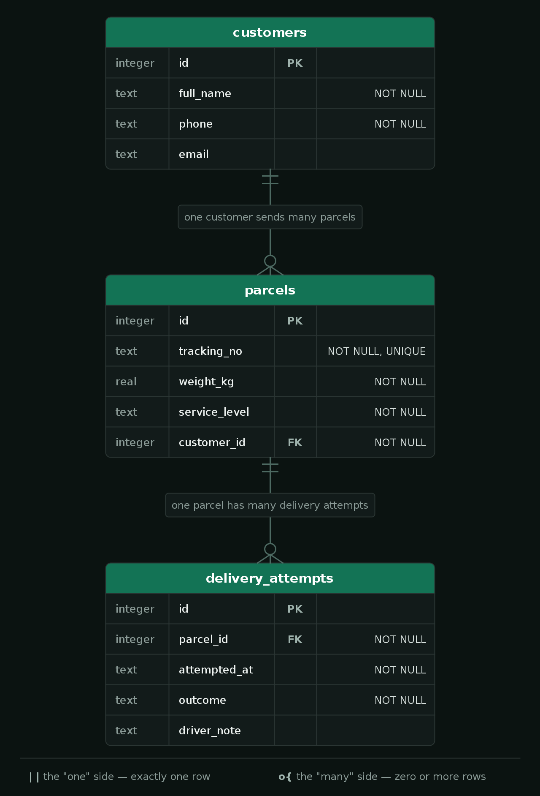

# Summative Assessment

## Learning Outcomes

| Learning Outcome | Section |
|---|---|
| Project Management / Agile | Section 1 |
| OOP / Greenfield Development | Section 2 |
| Brownfields Development | Section 3 |
| Build Pipelines / Scripting | Section 4 |
| Relational Database Design | Section 5 |
| Testing / Systems Design | Section 6 |
| Web Development | Section 7 |

---

## Duration

**Total time: 3 hours**

| Section | Recommended Time |
|---|---|
| Section 1 — Project Management | 20 minutes |
| Section 2 — OOP and Greenfield Development | 40 minutes |
| Section 3 — Brownfields Development | 15 minutes |
| Section 4 — Build and Release Management | 25 minutes |
| Section 5 — Database Schema Design | 20 minutes |
| Section 6 — Testing and Systems Design | 25 minutes |
| Section 7 — Web Development | 35 minutes |

---

## Scoring

| Section | Marks |
|---|---|
| Section 1 — Project Management | 13 |
| Section 2 — OOP and Greenfield Development | 20 |
| Section 3 — Brownfields Development | 8 |
| Section 4 — Build and Release Management | 13 |
| Section 5 — Database Schema Design | 10 |
| Section 6 — Testing and Systems Design | 16 |
| Section 7 — Web Development | 20 |
| **Total** | **100** |

To pass, your final score must be **60% or higher**.

---

## The Scenario

**SwiftParcel** is a South African courier company that collects parcels from senders, moves
them through regional hubs, and delivers them to recipients' doors. Sections 1 to 6 of
this assessment are about a part of SwiftParcel's software. Section 7 uses examples from the
Web Development curriculum.

This repository is **one Maven project**: `courier-service`, SwiftParcel's courier software.

| Package (under `src/main/java/za/co/wethinkcode/courier/`) | What it is | Used in |
|---|---|---|
| `dispatch/` | A brand-new parcel dispatch module that you build from scratch | Section 2 |
| `model/`, `service/` | The existing consignment rules, written by a previous team | Sections 3 and 6 |
| `Main`, `Database`, `DatabaseSchema`, `pom.xml`, pipeline | The application's entry point, database and build | Sections 4 and 5 |

Q7.1 uses a separate starter module, `webdev/`, which is not part of the Maven project.

The project compiles from the start, before you change anything, so you can complete the
sections in any order. **Keep it compiling as you work.** A compile error anywhere stops
every test in the project from running.

Write all written answers in `answers.txt`, under the matching question heading. Do not
change the format of the file or create a new one.

---

# Section 1 — Project Management

## Scenario

Salesforce.com — Agile at Scale

By 2006, Salesforce.com's research and development organisation had grown quickly, and its
way of delivering software had not kept up. Work moved through long phases: requirements were
gathered and signed off up front, then built, then handed over to be tested near the end.
Releases were getting later and smaller. The number of major releases a year had dropped to
about one, and the business could not predict what would be in a release or when it would
arrive.

In late 2006, the organisation moved every team at once to an Agile, Scrum-based way of
working. Work was planned and delivered in short time-boxed iterations, each team kept its own
prioritised backlog, and the product was kept in a releasable state. Within a year, the teams
were back on a regular, predictable release schedule and delivering more features than before.

You have been brought in as project manager for a new SwiftParcel team about to build a
similar product: **SwiftParcel Live Tracking**. Recipients should be able to enter a tracking
number and see where their parcel is. Drivers on the road should be able to record each
delivery attempt, including failed ones ("no one home", "wrong address", "refused"), so that
the recipient sees an accurate status.

Your first responsibility, before any code is written, is to set the team's way of working.

> **Reference:** Fry, C., and Greene, S. (2007). Large Scale Agile Transformation in an
> On-Demand World. *Agile 2007 (AGILE 2007)*, IEEE, pp. 136–142.

| Task | Marks | What earns marks |
|---|---|---|
| Q1.1 — Waterfall vs Agile | 4 | Accurate definition of both (2), clear reasoning tied to Salesforce's specific problems and how time-boxing addresses them (2) |
| Q1.2 — Establishing a way of working | 6 | Relevant guardrails, each explained (what it is, when it happens, what problem it prevents), that together give the team a complete, repeatable process |
| Q1.3 — Stand-up vs retrospective | 3 | Accurate comparison of purpose, timing and focus |

---

### Q1.1 — Waterfall vs Agile *(4 marks)*

Define and contrast the Waterfall model and Agile (time-boxed) delivery. Salesforce's problem
was not that its developers could not write code — it was that releases kept getting later,
smaller and harder to predict. Explain why a phase-by-phase process tends to produce exactly
those symptoms as an organisation grows, and how short, time-boxed iterations address them.

---

### Q1.2 — Establishing a Way of Working *(6 marks)*

You have just joined the Live Tracking team, and nobody has agreed how the team will work
together yet. Developers are picking up whatever they like, nobody knows who is working on
what, and problems are only discovered when someone happens to mention them.

What basic guardrails would you put in place so that the team has a clear, repeatable process
of working? For each guardrail, explain:

- what it is,
- when or how often it happens, and
- what problem it prevents for this team.

Include how the team will see the progress of every piece of work, from the moment it is
requested to the moment it is finished.

---

### Q1.3 — Stand-up vs Retrospective *(3 marks)*

A new developer on the team says: *"The stand-up and the retrospective are the same thing —
we all meet and talk about how things are going."*

Explain the difference between a daily stand-up and a sprint retrospective. Compare their
purpose, when and how often they happen, and what each one focuses on and produces.

---

# Section 2 — OOP and Greenfield Development

## Scenario

SwiftParcel is adding a new **parcel dispatch** module to `courier-service`, built from
scratch. Every parcel has a tracking number, a sender, a recipient address, a weight, and
whether it has been delivered. Parcels are sent at different service levels (Standard, Express
and Fragile), and each one prices and schedules delivery differently. Express and Fragile
parcels carry declared-value insurance; Standard parcels do not.

All of the work for this section is in the `dispatch` package.

| Task | Marks | What earns marks |
|---|---|---|
| Q2.1 — Implementation | 12 | `(dispatch tests passed / total dispatch tests) × 12` |
| Q2.2 — The pillars of OOP | 8 | Names and correctly defines each of the four pillars (1 each), explains how to recognise each one in a codebase with a correct example from the `dispatch` package (1 each) |

### Class Hierarchy

```
Parcel  (abstract)
├── StandardParcel
├── ExpressParcel   implements Insurable
└── FragileParcel   implements Insurable

Interface: Insurable      (provided — do not modify)
```

### Package Structure

```
src/
  main/java/za/co/wethinkcode/courier/dispatch/
    Insurable.java         (provided)
    Parcel.java
    StandardParcel.java
    ExpressParcel.java
    FragileParcel.java
    DispatchCentre.java
  test/java/za/co/wethinkcode/courier/dispatch/
    ParcelTest.java
    ParcelTypesTest.java
    InsurableTest.java
    DispatchCentreTest.java
    Types.java
```

The skeleton classes already contain their constructors and public methods, so the project
compiles. Each method body is a placeholder that throws `UnsupportedOperationException`.
**The design is yours to complete:** declare the fields, decide what is `abstract`, add the
`extends` and `implements` relationships, call `super(...)`, and replace every placeholder
with a real implementation, as described below. The tests check all of these.

> **Do NOT modify any test files or `Insurable.java`.**

Run only this section's tests with:

```bash
mvn test -Dtest='za.co.wethinkcode.courier.dispatch.*Test'
```

---

### Q2.1 — Implementation *(12 marks)*

Work through the steps **in order**. Each class builds on the ones before it.

#### Step 1 — Read `Insurable` (Interface — provided)

**File:** `dispatch/Insurable.java`

| Method | Details |
|---|---|
| `getDeclaredValue()` | Returns the value the sender declared for the contents, in Rands (`double`). |
| `insurancePremium()` | Returns the premium charged to insure the parcel, in Rands (`double`). |

---

#### Step 2 — Implement `Parcel` (Abstract)

**File:** `dispatch/Parcel.java`

`Parcel` is the root of the hierarchy. It holds the state every parcel shares, but it cannot
price or schedule a delivery on its own.

##### Fields

| Field | Type | Details |
|---|---|---|
| `trackingNumber` | `String` | Private and **immutable** |
| `senderName` | `String` | Private and **immutable** |
| `recipientAddress` | `String` | Private |
| `weightKg` | `double` | Private. Must always be greater than `0`. |
| `delivered` | `boolean` | Private. Starts as `false`. |

##### Constructor

Accepts `trackingNumber`, `senderName`, `recipientAddress`, `weightKg`. Throws
`IllegalArgumentException` if `weightKg` is zero or negative. Sets `delivered` to `false`.

##### Methods

| Method | Details |
|---|---|
| `getTrackingNumber()` | Returns the tracking number. No setter. |
| `getSenderName()` | Returns the sender's name. No setter. |
| `getRecipientAddress()` <br/> `updateRecipientAddress(String)` | Getter and updater. The updater throws `IllegalStateException` if the parcel has already been delivered. |
| `getWeightKg()` <br/> `updateWeightKg(double)` | Getter and updater. The updater throws `IllegalArgumentException` if the value is zero or negative. |
| `isDelivered()` <br/> `markDelivered()` | Returns whether the parcel has been delivered. `markDelivered()` sets it to `true`. |
| `toString()` | Returns a summary that includes the tracking number and the sender's name. |
| `deliveryFee()` | **Abstract.** Returns the delivery fee in Rands. |
| `deliveryDays()` | **Abstract.** Returns the number of working days delivery takes. |
| `serviceLevel()` | **Abstract.** Returns a short service level label. |

---

#### Step 3 — Implement `StandardParcel`, `ExpressParcel`, `FragileParcel`

All three extend `Parcel` and implement every abstract method. Use the `@Override` annotation
on every overridden method.

##### `StandardParcel`

| | Details |
|---|---|
| Extends | `Parcel` |
| Extra fields | None |
| Constructor | Accepts all `Parcel` parameters |
| `deliveryFee()` | `BASE_FEE + (weightKg × FEE_PER_KG)` |
| `deliveryDays()` | Returns `DELIVERY_DAYS` |
| `serviceLevel()` | Returns `"Standard"` |
| `toString()` | Includes `"Standard"` and the parent summary |

##### `ExpressParcel`

| | Details |
|---|---|
| Extends / implements | `Parcel`, `Insurable` |
| Extra fields | `declaredValue (double)` — private and **immutable**. |
| Constructor | Accepts all `Parcel` parameters, then `declaredValue`. Throws `IllegalArgumentException` if `declaredValue` is negative. |
| `deliveryFee()` | `BASE_FEE + (weightKg × FEE_PER_KG)` |
| `deliveryDays()` | Returns `DELIVERY_DAYS` |
| `serviceLevel()` | Returns `"Express"` |
| `insurancePremium()` | `declaredValue × INSURANCE_RATE` |
| `toString()` | Includes `"Express"` and the parent summary |

##### `FragileParcel`

| | Details |
|---|---|
| Extends / implements | `Parcel`, `Insurable` |
| Extra fields | `declaredValue (double)` — private and **immutable**. `handlingNotes (String)` — private and **immutable**; getter `getHandlingNotes()`. |
| Constructor | Accepts all `Parcel` parameters, then `declaredValue`, then `handlingNotes`. Throws `IllegalArgumentException` if `declaredValue` is negative. |
| `deliveryFee()` | `BASE_FEE + (weightKg × FEE_PER_KG)` |
| `deliveryDays()` | Returns `DELIVERY_DAYS` |
| `serviceLevel()` | Returns `"Fragile"` |
| `insurancePremium()` | `declaredValue × INSURANCE_RATE` |
| `toString()` | Includes `"Fragile"` and the handling notes |

> The constants (`BASE_FEE`, `FEE_PER_KG` and so on) are already declared in each skeleton
> file.
>
> **Hint:** inside a subclass, `weightKg` is private to `Parcel`, so use `getWeightKg()`.

---

#### Step 4 — Implement `DispatchCentre`

**File:** `dispatch/DispatchCentre.java`

`DispatchCentre` ties the system together: it holds every parcel at a centre and reports on
them.

##### Fields

| Field | Type | Details |
|---|---|---|
| `centreName` | `String` | Private and immutable. |
| `parcels` | `List<Parcel>` | Private. Every parcel at this centre. |

##### Constructor

Accepts `centreName`. Initialises `parcels` as an empty `ArrayList`.

##### Methods

| Method | Details |
|---|---|
| `getCentreName()` | Returns the centre name. |
| `addParcel(Parcel)` | Adds a parcel. Throws `IllegalArgumentException` if a parcel with the same tracking number is already present. |
| `findParcel(String trackingNumber)` | Returns the `Parcel`, or `null` if not found. |
| `getParcels()` | Returns `Collections.unmodifiableList(parcels)`. |
| `insurableParcels()` | Returns a **new** `List<Insurable>` holding every parcel that is `Insurable`. *(Hint: `instanceof`.)* |
| `totalDeliveryRevenue()` | Sums `deliveryFee()` across all parcels. Returns `0.0` if there are none. |
| `totalInsurancePremiums()` | Sums `insurancePremium()` across all insurable parcels. Returns `0.0` if there are none. |

---

### Q2.2 — The Pillars of OOP *(8 marks)*

Object-oriented programming rests on four key pillars.

For **each** of the four pillars:

1. Name it and define it in your own words.
2. Explain how you would identify it when reading a codebase: what keywords, structures or
   patterns tell you it is being used?
3. Point to one place in the `dispatch` package where it appears (name the class and the
   field, method or declaration) and explain briefly why that is an example of the pillar.

---

# Section 3 — Brownfields Development

## Scenario

The `model` and `service` packages hold SwiftParcel's existing rules service, written by a
team that has since moved on. `DeliveryRulesService` decides whether a consignment can be
loaded onto a driver's vehicle (`canLoadOntoVehicle`) and what should happen after a delivery
attempt (`decideNextStep`). It works, and `DeliveryRulesServiceTest` covers it, but both methods
are hard to read, and the business wants new delivery rules added next sprint.

Read `DeliveryRulesService` before you answer. **You do not change any code in this section.**
Both answers go in `answers.txt`.

| Task | Marks | What earns marks |
|---|---|---|
| Q3.1 — Refactoring | 3 | Accurate definition (1), clear distinction from other kinds of change (1), a relevant example from `DeliveryRulesService` (1) |
| Q3.2 — Changing code safely | 5 | Names and explains a suitable development approach (2), describes each stage of its cycle correctly (2), applies it to the example rule (1) |

---

### Q3.1 — Refactoring *(3 marks)*

Your team lead asks you to refactor `DeliveryRulesService` before any new rules are added.

Explain what refactoring is, and how it differs from fixing a bug or adding a feature. Use one
of the two methods in `DeliveryRulesService` as an example of code that would benefit from it,
and say what you would want to improve.

---

### Q3.2 — Changing Code Safely *(5 marks)*

The team lead adds a condition: no driver or customer may notice any change in behaviour while
you restructure the code, and the new rules the team adds next sprint must be built in a way
that keeps that true for the next team as well.

The first new rule is: *a consignment heavier than 30 kg cannot be loaded unless the driver is
working with a second driver.*

Describe the development approach you would follow, both while you restructure the existing
code and when you add this new rule. Name the approach and explain why it keeps behaviour safe.
Then walk through each stage of the cycle it follows, saying what you would do at each stage
for the 30 kg rule and how you know when to move on to the next stage.

---

# Section 4 — Build and Release Management

## Scenario

`courier-service` is built with Maven, and its `Makefile` has the targets you can run locally:
`make compile`, `make test` and `make package`. The team is getting ready to release and needs a
GitLab CI pipeline.

| Task | Marks | What earns marks |
|---|---|---|
| Q4.1 — Releasing a snapshot | 4 | Correct explanation of `-SNAPSHOT` and why it must not reach customers (1), correct release version (1), justification that addresses each change (2) |
| Q4.2 — "It builds, but it won't run" | 4 | Correctly explains why the tests can reach the database but the packaged jar cannot (2), fix applied so the packaged jar runs and creates `courier.db` (2) |
| Q4.3 — Complete the pipeline | 3 | The pipeline runs the required jobs in the required order (1), the built jar can be downloaded once the pipeline finishes (1), a correct explanation of why the order matters (1) |
| Q4.4 — The `pom.xml` file | 2 | Correct explanation of what the file is for (1), two things this project's `pom.xml` defines, each with what Maven does with it (1) |

---

### Q4.1 — Releasing a Snapshot *(4 marks)*

Open `pom.xml`. The project's version is `1.4.0-SNAPSHOT`. The last version released to
customers was `1.3.2`.

**Q4.1.1** Explain what the `-SNAPSHOT` suffix means and why a snapshot build should never be
handed to customers.

**Q4.1.2** Since `1.3.2`, the following changes have been merged:

- A rounding defect in delivery fee quotes was fixed.
- A new public method, `estimateDeliveryDate(...)`, was added. No existing method changed.
- The deprecated public method `DispatchClient.sendLegacy()` was removed. A partner team's
  integration still calls it.

The team plans to release this as `1.4.0`. Is that the correct version? State the version you
would release and justify it with reference to **each** of the three changes.

---

### Q4.2 — "It Builds, But It Won't Run" *(4 marks)*

Package the application and run it:

```bash
make package
java -jar target/courier-service-jar-with-dependencies.jar
```

The build succeeds, and the application prints two lines and then crashes. Yet the tests in
`DatabaseSchemaTest` can open a database connection on the same machine without any problem.

Find the cause in `pom.xml` and fix it so that the packaged jar runs to the end and creates
`courier.db`. In `answers.txt`, explain why the tests could reach the database driver but the
packaged jar could not.

> Do not change any Java code to fix this.
>
> You can look up artefacts on [Maven Central](https://mvnrepository.com/repos/central).

---

### Q4.3 — Complete the Pipeline *(3 marks)*

`.gitlab-ci.yml` has been started for you. Complete it so that the pipeline:

1. **compiles** the code,
2. then **runs the test suite**,
3. then **packages** the application, and keeps the built jar so it can be downloaded from the
   pipeline page once the pipeline finishes.

Each job should run the matching `Makefile` target. Then, in `answers.txt`, explain why the
pipeline must run these steps in this order.

> You are allowed to use the [GitLab CI/CD YAML docs](https://docs.gitlab.com/ci/yaml/).

---

### Q4.4 — The `pom.xml` File *(2 marks)*

Every Maven project, including `courier-service`, has a `pom.xml` at its root.

Explain what the `pom.xml` file is for: what would a team have to do by hand, on every machine
and in the pipeline, if the project did not have one? Then point to **two** different things
this project's `pom.xml` defines, and explain what Maven does with each of them.

---

# Section 5 — Database Schema Design

## Scenario

SwiftParcel Live Tracking needs to store customers, their parcels, and every delivery attempt
made on each parcel. `resources/erd.png` is the entity relationship diagram for the three
tables you need to create:



A `Database` class is already provided and knows how to open a JDBC connection to a SQLite
database. `DatabaseSchema.createSchema(Connection connection)` is where the schema itself is
created, but the method body is currently empty.

> `resources/SQL-Cheat-Sheet.pdf` is provided as a reference if you need a refresher on SQL
> syntax (data types, constraints, `CREATE TABLE`, etc.).

| Task | Marks | What earns marks |
|---|---|---|
| Q5.1 — Tables, columns and types | 3 | All three tables created with exactly the columns and types in the ERD (1 per table) |
| Q5.2 — Primary keys and NOT NULL | 2 | `id` is the primary key of every table (1), `NOT NULL` applied exactly as in the ERD, and nowhere else (1) |
| Q5.3 — Foreign keys | 3 | `parcels.customer_id` references `customers.id` (1.5), `delivery_attempts.parcel_id` references `parcels.id` (1.5) |
| Q5.4 — Unique tracking numbers | 2 | `parcels.tracking_no` declared `UNIQUE` (1), written explanation (1) |

---

### Q5.1 – Q5.3 — Create the Schema *(8 marks)*

Implement `DatabaseSchema.createSchema(Connection connection)` so that it creates the
`customers`, `parcels` and `delivery_attempts` tables exactly as shown in the ERD, using
standard SQL `CREATE TABLE` statements executed through the JDBC `Connection` you are given.

> This task is schema creation only — you are not inserting or querying any data.
>
> Think about the order in which the tables must be created.
>
> Run `mvn test -Dtest=DatabaseSchemaTest` to check your schema.

---

### Q5.4 — Unique Tracking Numbers *(2 marks)*

Declare the `UNIQUE` constraint on `parcels.tracking_no` as shown in the ERD.

Then, in `answers.txt`: every parcel already has a tracking number that is unique and never
empty, so a teammate asks why the table needs a separate `id` column at all. Explain the
difference between a `PRIMARY KEY` and a `UNIQUE` constraint, and give one reason why
`delivery_attempts` references `parcels.id` rather than `parcels.tracking_no`.

---

# Section 6 — Testing and Systems Design

| Task | Marks | What earns marks |
|---|---|---|
| Q6.1 — Types of Testing | 4 | Each of the three checks correctly classified with a justification (1 each), explanation of what the third check confirms that the other two cannot (1) |
| Q6.2 — Diagramming and UML | 4 | Intention of diagramming (1), what UML is and what it is for (1), what a UML diagram is (1), difference between a class diagram and a sequence diagram (1) |
| Q6.3 — UML Class Diagram | 8 | Both classes with correct fields, visibility and methods (3), relationships with correct multiplicity (2), written explanation of how the same relationship appears in the ERD (3) |

---

### Q6.1 — Types of Testing *(4 marks)*

SwiftParcel runs three checks before a release:

1. `DeliveryRulesServiceTest` — the existing tests for the rules service from Section 3. They
   create `Consignment` and `Driver` objects in memory and call one method of
   `DeliveryRulesService` at a time.
2. `DatabaseSchemaTest` — opens a real SQLite connection through `Database`, runs
   `DatabaseSchema`, and then inspects the tables that were created in the database.
3. A release check run by the operations team. It launches the packaged jar and confirms that,
   for a list of scenarios agreed with the business ("a refused parcel is returned to sender",
   "a same-day parcel can go to any zone"), the service gives the outcome the business signed
   off on. The team has no knowledge of how the code is written.

Name the type of testing each check represents and justify each classification. Then explain
what the third check confirms that the first two cannot.

---

### Q6.2 — Diagramming and UML *(4 marks)*

Before you draw anything in Q6.3, answer the following in `answers.txt`:

**Q6.2.1** What is the intention of diagramming when designing or documenting software? Why do
teams draw diagrams instead of only reading the code?

**Q6.2.2** What is UML (Unified Modeling Language), and what is its intention?

**Q6.2.3** Define what a UML diagram is.

**Q6.2.4** Class diagrams and sequence diagrams are both UML diagrams. Classify each one by the
category of UML diagram it belongs to, and explain the difference between them: what each one
shows, and what question each one helps a developer answer.

---

### Q6.3 — UML Class Diagram *(8 marks)*

Produce a UML class diagram of these two classes from the `courier-service` `model` package:
`Consignment` and `DeliveryAttempt`. (You do not need to include `Driver`, `ServiceLevel` or
`AttemptOutcome`. Where a field or method uses one of those types, just write the type name,
in the same way you would write `String`.)

Your diagram must show:

- Each class name
- All fields with their types and access modifiers (`+` public, `-` private, `#` protected)
- All methods with their return types and parameters
- The relationship between the two classes, with multiplicities on each end

Draw your diagram in your project's **GitLab wiki** — no other tool is allowed:

1. On your GitLab project's landing page, click **Add Wiki**.
2. Title the page **`UML Class Diagram`**.
3. In the editor toolbar, click the **Insert or edit diagram** icon (it looks like three small
   connected boxes, like a tiny org chart) and draw your diagram in the diagram editor that opens.
4. Save the diagram, then save the wiki page.

Then, in `answers.txt`: your class diagram and the ERD in Section 5 both describe the
relationship between a parcel and its delivery attempts. Explain how that same one-to-many
relationship is represented in the Java objects, how it is represented in the database tables,
and which side "holds" the relationship in each.

---

# Section 7 — Web Development: The Whole Stack

## Scenario

Show that you understand how the web works: how a browser loads and runs a page, how a web
application handles requests and remembers its users, and where a page's work can happen.

Q7.1 has starter code in the `webdev/` module. It is not part of the Maven project, so nothing
in it is compiled or run by `mvn` or the pipeline. Q7.2 and Q7.3 are written questions about concepts:
you do not read or write any code for them, but you must apply each idea to the situation
described.

| Task | Marks | What earns marks |
|---|---|---|
| Q7.1 — The browser side | 6 | Q7.1.1: the script works as described (2). Q7.1.2: an accurate, complete and correctly ordered walkthrough that explains why each step happens (4) |
| Q7.2 — How a web application remembers you | 8 | Accurate explanation of each concept, applied to the WeShare login: Q7.2.1 (2), Q7.2.2 (2), Q7.2.3 (3), Q7.2.4 (1) |
| Q7.3 — Server-side vs client-side page generation | 6 | Accurate explanation of each concept, applied to the bank's page: Q7.3.1 (2), Q7.3.2 (2), Q7.3.3 (1 per requirement, with a justification) |

---

### Q7.1 — The Browser Side *(6 marks)*

Here is the introduction's page, `webdev/hello-world/index.html`:

```html
<!DOCTYPE html>
<html>
    <head>
        <title>Hello, hello</title>
        <link rel="stylesheet" href="css/styles-2.css"/>
        <script src="js/update.js" defer></script>
    </head>
    <body>
        <h1>Hello, world</h1>
        <p>Using any of the following languages
            write a program that prints out <em>Hello, world</em>
            to the console</p>
        <ul id="languages">
            <li>Java</li>
            <li>Ruby</li>
            <li>Python</li>
        </ul>
        <p id="selection"></p>
    </body>
</html>
```

**Q7.1.1** Complete `webdev/hello-world/js/update.js` so that clicking a language in the list
shows *You chose* followed by that language in the empty paragraph. For example, clicking
"Python" shows "You chose Python". Do not change `index.html`. You can open `index.html` in a
browser to try it.

**Q7.1.2** Walk through what happens, from the browser's first HTTP request until clicking
"Python" shows "You chose Python" on the page.

---

### Q7.2 — How a Web Application Remembers You *(8 marks)*

A student opens WeShare, enters their email address on the login page, clicks Login, and lands
on a page listing their own expenses.

**Q7.2.1** When the student clicks Login, the browser sends the form to the server. Explain the
difference between an HTTP **GET** and an HTTP **POST** request, and say which one the login
form should use and why. *(2 marks)*

**Q7.2.2** HTTP is described as **stateless**. Explain what that means. Then explain how WeShare
can still know which student is asking for the expenses page, even though it is a separate
request from the login. *(2 marks)*

**Q7.2.3** WeShare is built with the **Model–View–Controller** pattern. Explain the job of each
part, and say what each one would be responsible for in this login-to-expenses journey.
*(3 marks)*

**Q7.2.4** After a successful login, the server tells the browser to go to the expenses page
instead of returning the expenses page straight away. Explain why web applications do this.
*(1 mark)*

---

### Q7.3 — Server-Side vs Client-Side Page Generation *(6 marks)*

A bank's web app shows a logged-in user their account balances when they visit
`/balances.html`. The page could be generated on the server or in the browser.

**Q7.3.1** Explain server-side page generation and client-side page generation for this page.
For each approach, say where the work happens and what the browser receives. *(2 marks)*

**Q7.3.2** In the client-side approach, the browser asks the server for the balances as data
rather than as a finished page. Explain what an **API endpoint** is, and why it usually
returns its data as JSON rather than HTML. *(2 marks)*

**Q7.3.3** The bank now has two new requirements for this page:

1. The balances must update every 30 seconds without the whole page reloading.
2. The balances must still be shown to customers whose browsers have JavaScript switched off.

For each requirement, say which approach meets it and justify your choice. Is there a way to
meet both? *(2 marks)*

---

### End of Assessment

---

## Repository Structure

```
.
├── README.md
├── answers.txt
├── pom.xml
├── Makefile
├── .gitlab-ci.yml
├── resources/
│   ├── erd.png
│   └── SQL-Cheat-Sheet.pdf
├── webdev/                  # Section 7 starter module — separate from the Maven project
│   └── hello-world/         # Q7.1 — index.html and css provided; you complete js/update.js
├── src/
│   ├── main/java/za/co/wethinkcode/courier/
│   │   ├── Main.java
│   │   ├── Database.java
│   │   ├── DatabaseSchema.java
│   │   ├── dispatch/            # Section 2 — Parcel hierarchy, Insurable, DispatchCentre
│   │   ├── model/               # Sections 3 and 6 — Consignment, Driver, DeliveryAttempt, ServiceLevel, AttemptOutcome
│   │   └── service/             # Section 3 — DeliveryRulesService (read only)
│   └── test/java/za/co/wethinkcode/courier/
│       ├── DatabaseSchemaTest.java
│       ├── dispatch/            # Section 2 tests
│       └── service/DeliveryRulesServiceTest.java
```

## Useful Commands

```bash
# Compile the source code
mvn compile

# Run every test
mvn test

# Run only one section's tests
mvn test -Dtest='za.co.wethinkcode.courier.dispatch.*Test'   # Section 2
mvn test -Dtest=DeliveryRulesServiceTest                     # Section 3 / Q6.1
mvn test -Dtest=DatabaseSchemaTest                           # Section 5

# Package the application into a jar (does not run the tests)
make package

# Run the packaged jar
java -jar target/courier-service-jar-with-dependencies.jar
```

The `Makefile` wraps the same commands, and is what your GitLab CI pipeline should run:

```bash
make compile
make test
make package
```

---

**NOTE:** Before pushing your solution for grading, make sure it compiles by running
`mvn clean compile test-compile`. If it does not compile, no tests can run, and that will
cost you marks in every section.
